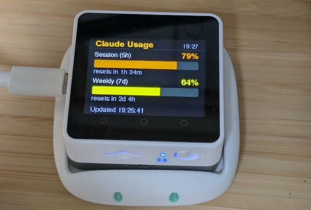

# M5 Claude Usage

Shows Claude subscription usage on an M5Stack Core2/CoreS3: the session (5h) and weekly (7d) windows as bars with percentages, refreshed every few minutes.



The numbers come from `GET https://api.anthropic.com/api/oauth/usage`, the undocumented endpoint behind the `/usage` command of Claude Code.

## Setup

 1. Create the config from the template:

    ```
     cp src/config.h.template src/config.h
    ```

    Fill in `WIFI_SSID` and `WIFI_PASSPHRASE`.

 2. Mint an OAuth token pair for the device:

    ```
    python3 tools/mint_token.py            # prints an authorize URL
    python3 tools/mint_token.py '<code>'   # exchange the code shown after approval
    ```

    This runs the PKCE flow against the Claude Code public client, verifies the result against the usage endpoint, and writes both `#define` lines into `src/config.h` itself. The tokens are never printed, so they stay out of your shell history.

 3. Build and flash:

    ```
    pio run -e <env> -t upload
    ```

## Token handling

Access tokens live 8 hours. The firmware refreshes them on a `401` and stores the result in NVS, because the server rotates the refresh token on every refresh — the value in `config.h` is only a seed for the first boot. Re-minting and reflashing is detected (the seed is stored alongside), so the new tokens take effect without erasing NVS.

Refresh tokens carry their own deadline, reported as `refresh_token_expires_in` and observed at about 25 days. Refreshing does not extend it: the deadline is fixed when the authorization is granted, so the device stops working once it passes and needs re-minting and reflashing roughly monthly. The firmware recognises the resulting `invalid_grant` and shows `token expired - re-mint` rather than a status code.

## Notes

- `tools/mint_token.py --refresh` rotates the pair in `config.h` as a smoke test of the same flow the firmware performs.
- Polling is 180 s by default (`CLAUDE_FETCH_INTERVAL_SEC`); failures back off from 30 s to 10 min and the last good values stay on screen, dimmed.
- Each bar has a vertical time marker at the point the window has elapsed to. Fill past the marker means the window is being consumed faster than it elapses. The bar colour follows the same pace, usage over the elapsed share: green below 0.75, yellow up to 1.0, orange below 1.25, red from there or at 100%. The pace is taken against a marker of at least 20%, so a fresh window does not turn red at the first message. Until the clock has synced, or when the API reports no reset time, there is no marker, and the colour falls back to usage alone (yellow from 50%, orange from 75%, red from 90%).
- Once a window reaches 100% the screen switches to a countdown to its reset: a ring of the time left on the left, the hours and minutes beside it. With both windows at their limit it counts down to the later reset, since that is when work resumes.
- Touch button A forces an immediate refresh, touch button C switches between the bars and the countdown. Below the limits the countdown is for whichever window resets first. The switch is dropped once a limit is reached or cleared, so the screen goes back to choosing for itself.
- `src/config.h` holds live credentials and is gitignored.
